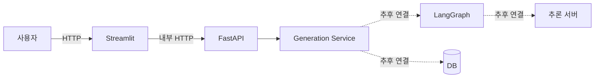

# 초기 서비스 아키텍처

## 문서 목적

이 문서는 POC에서 검증한 사용자 흐름을 팀 프로젝트의 초기 코드 구조로 옮기기 위한 기준을 정의합니다. 현재 단계에서는 기능을 완성하기보다 팀원이 독립적으로 작업할 수 있는 경계와 교체 지점을 만드는 것을 목표로 합니다.

## POC 계승 원칙

POC는 서비스 요구사항과 파이프라인의 원형으로 사용합니다.

- 계승: 반문, 컨텍스트 수집, 광고 문구 생성, 결과 평가, 이미지 생성, 채널별 변환 흐름
- 계승: `graph`와 `nodes`로 나눈 LangGraph 구성, 단일 생성 파이프라인 진입점
- 개선: API, 요청·응답 스키마, 서비스 로직, DB 접근을 서로 다른 계층으로 분리
- 개선: 실행환경은 루트 `uv.lock`과 Docker Compose를 기준으로 통일
- 보류: 로그인, 결제, DB 스키마, Triton 계약, 최종 그래프 상태는 요구사항 확정 후 반영

POC 코드를 그대로 복사하지 않고, 기능 담당자가 작성한 노드와 모델 코드를 아래 경계에 맞춰 옮깁니다.

## 초기 실행 구조



- 외부 사용자는 Streamlit으로 접근합니다.
- Streamlit은 Docker 네트워크에서 `backend:8000`으로 FastAPI를 호출합니다.
- API 계층은 요청 검증과 HTTP 응답만 담당합니다.
- 서비스 계층은 생성 유스케이스를 조율하며, 현재는 목 결과를 반환합니다.
- LangGraph, DB, 추론 서버는 서비스 계층 아래의 교체 가능한 구현으로 연결합니다.

## 목표 디렉터리 구조

```text
backend/
├── app/
│   ├── main.py                 # 애플리케이션 생성과 라우터 등록
│   ├── api/
│   │   ├── router.py           # API 라우터 통합
│   │   └── routes/             # HTTP 엔드포인트
│   ├── core/                   # 환경 설정과 공통 정책
│   ├── schemas/                # 요청·응답 계약
│   ├── services/               # 생성 유스케이스 조율
│   ├── graph/                  # LangGraph 상태와 그래프 조립
│   ├── nodes/                  # 담당자별 그래프 노드
│   ├── clients/                # 외부 API와 추론 서버 클라이언트
│   └── repositories/           # DB 접근 인터페이스와 구현
└── Dockerfile

frontend/
├── app.py                      # Streamlit 화면 진입점
├── api_client.py               # FastAPI 호출 경계
└── Dockerfile

tests/
├── api/                        # HTTP 계약 검증
└── services/                   # 서비스 로직 검증
```

`graph`, `nodes`, `clients`, `repositories`는 실제 요구사항이 확정될 때 생성합니다. 사용하지 않는 빈 추상화는 미리 추가하지 않습니다.

## 초기 API 계약

초기 API는 컨테이너 연결과 서비스 계층 교체를 검증하기 위한 임시 계약입니다.

### 상태 확인

```text
GET /health
```

```json
{"status": "ok"}
```

### 광고 콘텐츠 생성

```text
POST /generate
```

```json
{"prompt": "여름 신메뉴 광고 문구를 만들어줘"}
```

```json
{
  "request_id": "UUID",
  "status": "completed",
  "result": {
    "text": "생성 결과"
  }
}
```

요구사항 확정 후 업종, 채널, 플랜, 대화 이력, 컨텍스트 선택 항목을 스키마에 추가합니다. 변경 시 프론트엔드와 모델 담당자가 함께 API 계약을 검토합니다.

## 계층별 책임

| 계층 | 책임 | 포함하지 않는 것 |
| --- | --- | --- |
| API | HTTP 입력 검증, 상태 코드, 응답 직렬화 | LangGraph 노드 구현, 직접 DB 쿼리 |
| Service | 생성 흐름 조율, 트랜잭션과 정책 적용 | FastAPI 객체, Streamlit 상태 |
| Graph/Node | 상태 정의, 노드 실행, 조건부 라우팅 | HTTP 응답 형식, 화면 처리 |
| Client | 외부 API와 추론 서버 통신 | 비즈니스 흐름 결정 |
| Repository | DB 읽기·쓰기 | 생성 모델 호출 |

## 현재 범위 밖

- 실제 인증 및 결제
- DB 종류와 영속화 스키마
- Triton 모델 이름, 입력·출력 tensor 계약
- 이미지 저장 위치와 보존 기간
- 운영용 Nginx, HTTPS, CI/CD
- LangGraph 최종 상태와 노드 순서

위 항목은 서비스 요구사항과 담당자별 구현안이 나온 뒤 별도 ADR 또는 관련 문서에 기록합니다.
